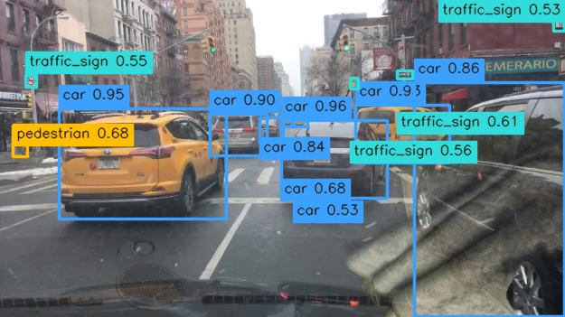
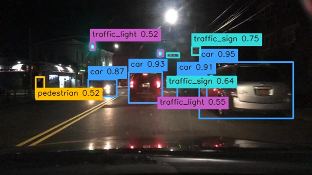
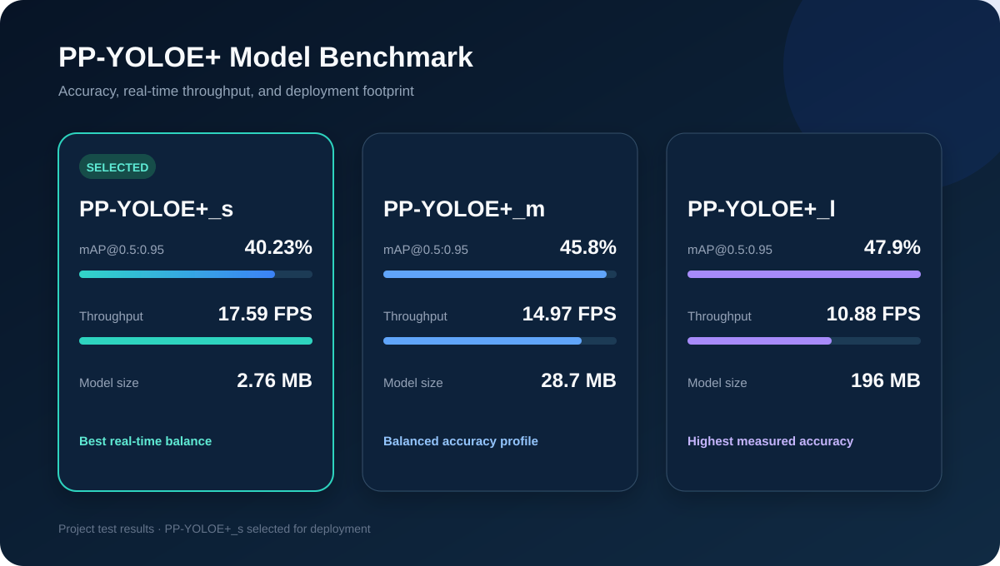

# Intelligent Vehicle Environment Perception and Real-Time Object Detection System Based on PP-YOLOE+

<p align="center">
  <a href="LICENSE"></a>
  <a href="https://docs.openvino.ai/"></a>
  <a href="#quick-start"></a>
</p>

<p align="center">
  
</p>

## Overview

This project delivers a practical road-scene perception workflow built around
PP-YOLOE+ and an OpenVINO IR model. It detects traffic participants and roadside
objects in images or a live camera stream, then renders readable annotations and
can export competition-format JSON.

The supported path is CPU inference: the supplied IR is loaded directly by
OpenVINO, so TensorFlow and a retraining environment are not required. The model
has 13 named traffic classes: `rider`, `pedestrian`, `other_vehicle`, `trailer`,
`train`, `bus`, `car`, `truck`, `traffic_sign`, `traffic_light`, `other_person`,
`motorcycle`, and `bicycle`.

## Core Features

- OpenVINO CPU inference for the supplied PP-YOLOE+ model.
- Single-image and batch-directory commands with annotated output images.
- Live webcam mode with double-buffered inference and clean shutdown.
- Deterministic NumPy class-aware NMS; no TensorFlow dependency.
- Competition-style JSON export with boxes, categories, and confidence scores.
- Shape-based output routing: boxes and scores are not coupled to output-port order.
- Explicit handling for the model's extra score channel. The named class list remains
  limited to 13 labels; an unexpected fourteenth-channel detection is shown as
  `unknown` rather than silently assigned to a named class.

## Demo

The screenshots below are produced by the included OpenVINO model on the project
road scenes. Caption placement automatically avoids collisions for legibility.

| Daytime road scene | Night-time road scene |
| :---: | :---: |
|  |  |

The comparison graphic is available as a repository-native SVG:



## Quick Start

### 1. Environment installation

Python 3.10+ is required. The verified CPU runtime is OpenVINO 2024.6.0.

```bash
git clone https://github.com/Jiangyou-rhyyy/PP-YOLOE-Intelligent-Vehicle-Perception.git
cd PP-YOLOE-Intelligent-Vehicle-Perception

python -m venv .venv
# Windows PowerShell
.\.venv\Scripts\Activate.ps1
# macOS / Linux
# source .venv/bin/activate

pip install -r requirements.txt
pip install -e .
```

### 2. Download the model bundle

Model weights are kept out of normal Git history. Download the release bundle;
the helper validates its SHA-256 checksum and places the expected files in `model/`.

```bash
python scripts/download_models.py
```

You should then have `model/model.xml` and `model/model.bin`.

### 3. Dataset preparation

No external dataset is needed to run the packaged inference demos. The two small
road-scene inputs used above are included under `assets/source/`.

For optional training or independent evaluation, download BDD100K from the
[official project page](https://www.vis.xyz/bdd100k/) and follow its access terms.
BDD100K images and annotations are intentionally not redistributed here. The
historical training environment is preserved only as reference in `docs/legacy/`;
the supported workflow in this repository is inference.

### 4. Run image inference

```bash
python scripts/detect_images.py \
  --model model/model.xml \
  --labels model/labels.txt \
  --image assets/source/day.jpg \
  --output-dir outputs/images \
  --json-dir outputs/json
```

For a folder of images, replace `--image` with `--image-dir data/images`.

### 5. Run webcam inference

```bash
python scripts/detect_webcam.py \
  --model model/model.xml \
  --labels model/labels.txt \
  --camera 0 \
  --window-size 960x540
```

Press <kbd>Esc</kbd> to close the live window.

## Project Structure

```text
.
├── assets/                    # source scenes, real detections, GIF, benchmark SVG
├── data/
│   ├── images/                # optional batch input directory
│   └── results/               # optional local result directory
├── docs/
│   ├── legacy/                # historical environment references
│   └── project-report-zh.pdf  # project report
├── model/
│   ├── labels.txt             # 13 named classes
│   └── README.md              # release model manifest and runtime contract
├── scripts/
│   ├── detect_images.py       # image/directory inference
│   ├── detect_webcam.py       # live camera inference
│   └── download_models.py     # verified release download helper
├── src/vehicle_perception/    # preprocessing, model runner, NMS, visualization, I/O
└── tests/                     # unit, CLI, asset, and documentation checks
```

## Results

The following are the project's measured PP-YOLOE+ test results. `PP-YOLOE+_s`
is selected for the packaged real-time deployment path.

| Model | mAP@0.5:0.95 | Throughput | Model size |
| --- | ---: | ---: | ---: |
| PP-YOLOE+_s | 40.23% | 17.59 FPS | 2.76 MB |
| PP-YOLOE+_m | 45.8% | 14.97 FPS | 28.7 MB |
| PP-YOLOE+_l | 47.9% | 10.88 FPS | 196 MB |

Current CPU smoke verification with the packaged `PP-YOLOE+_s` OpenVINO IR
produced 13 detections on the included daytime scene and 9 on the included
night-time scene. The runtime contract, including the `[1, 8400, 4]` box output
and `[1, 14, 8400]` score output, is documented in [model/README.md](model/README.md).

## Dataset & Acknowledgements

- [BDD100K](https://www.vis.xyz/bdd100k/) provides the driving-scene dataset
  context. Please obtain it from the official source and comply with its terms.
- [PaddleDetection](https://github.com/PaddlePaddle/PaddleDetection) provides the
  PP-YOLOE implementation lineage.
- [PP-YOLOE: An Evolved Version of YOLO](https://arxiv.org/abs/2203.16250) is the
  associated research paper by Xu et al.
- [OpenVINO](https://docs.openvino.ai/) provides the inference runtime used here.

See [THIRD_PARTY_NOTICES.md](THIRD_PARTY_NOTICES.md) for licensing and attribution
details. The project code and documentation are available under the
[Apache-2.0 License](LICENSE).
